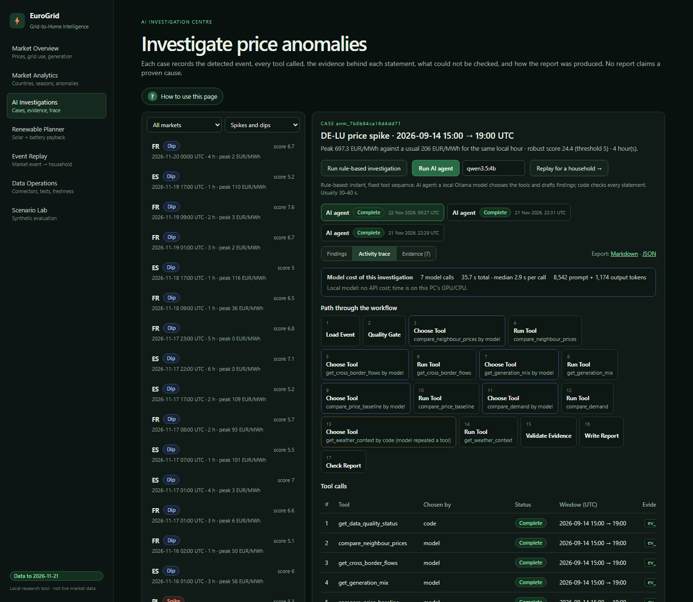
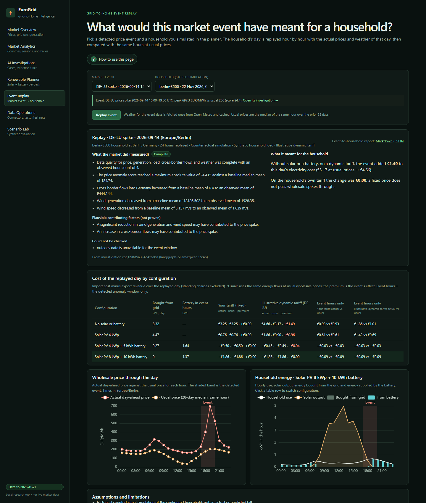
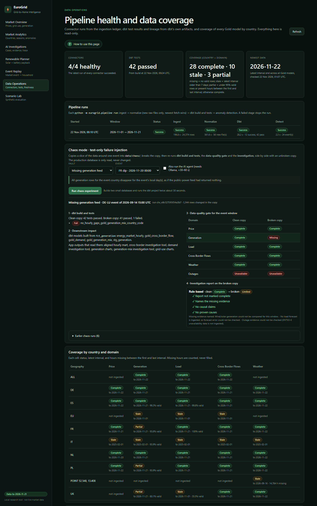
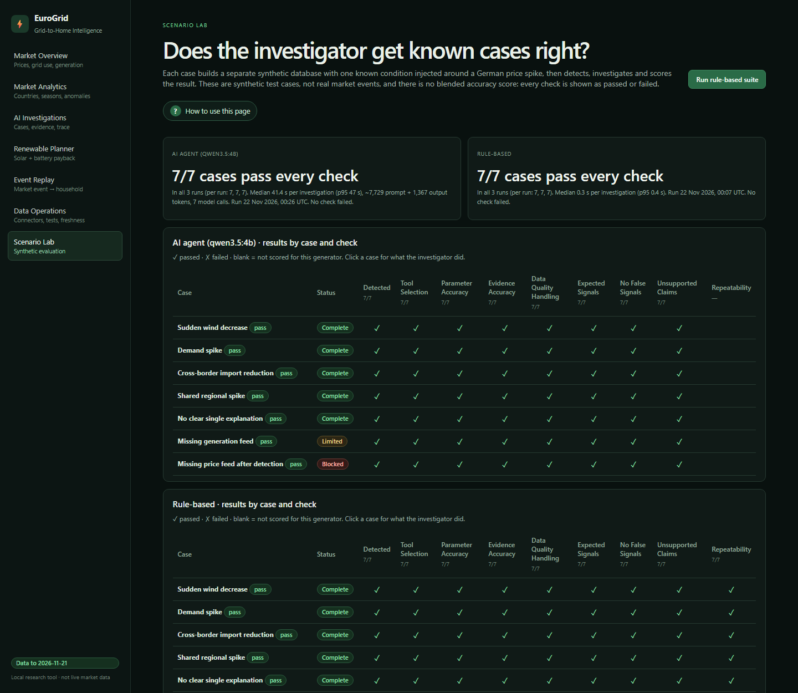
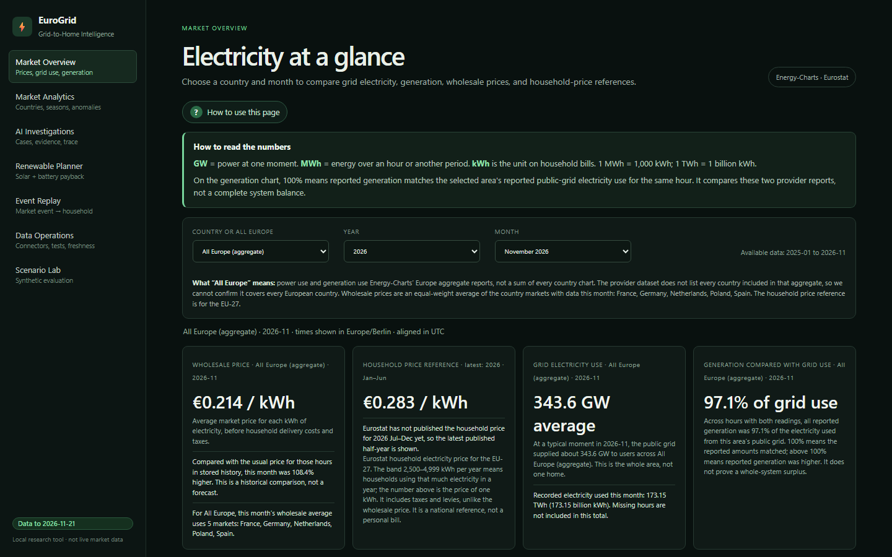
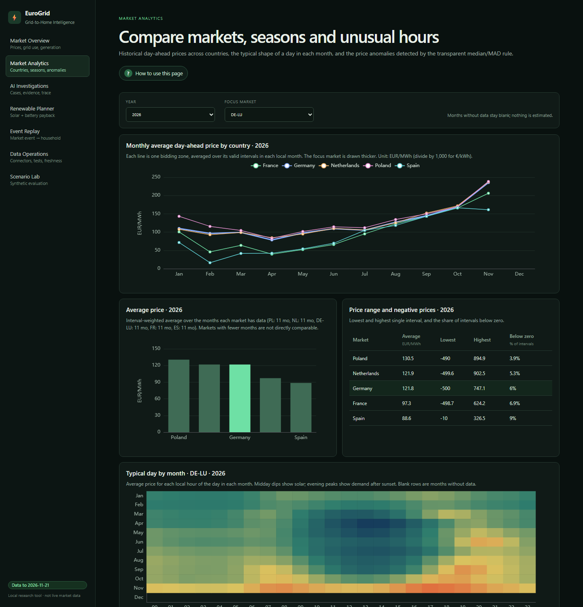
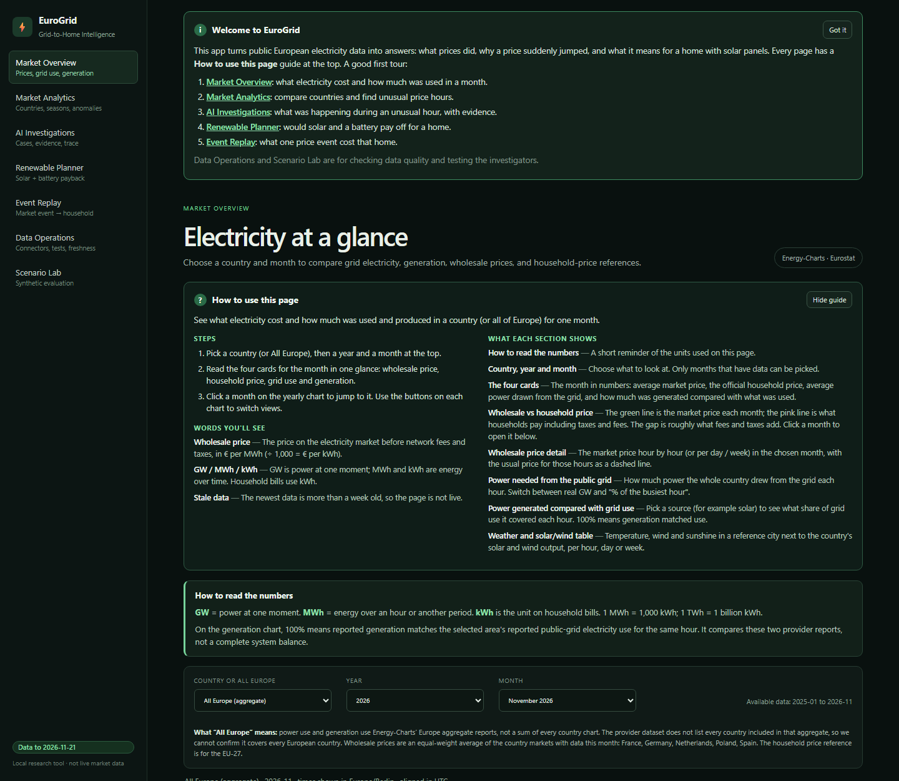
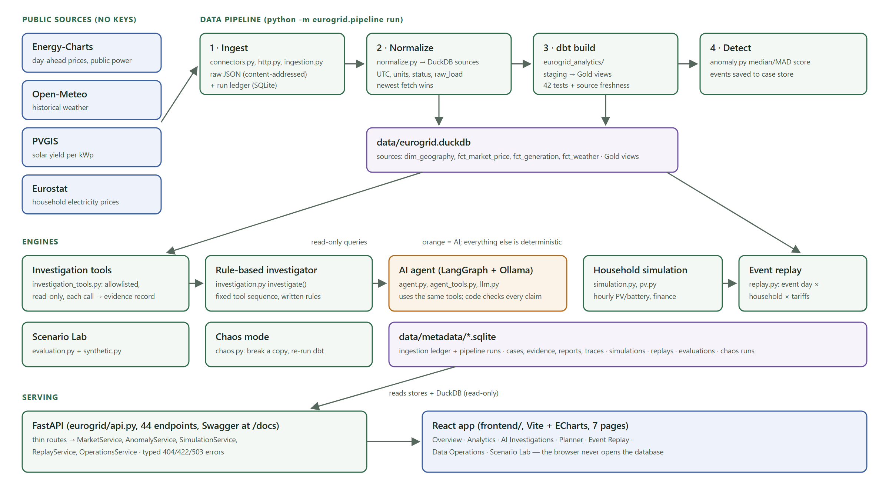

# EuroGrid Intelligence

[](https://github.com/mohamed-mnasri/eurogrid-intelligence/actions/workflows/ci.yml)


**A local data and AI platform for European electricity markets.** It collects public market data with a tested pipeline, explains unusual price hours with evidence (using rules or a local AI model whose every statement is checked by code), and shows what a price event would have meant for a home with solar panels and a battery.



## Contents

- [Why this project](#why-this-project)
- [Highlights](#highlights)
- [Screenshots](#screenshots)
- [Features](#features)
- [Architecture](#architecture)
- [Tech stack](#tech-stack)
- [Getting started](#getting-started)
- [Usage](#usage)
- [Testing and CI](#testing-and-ci)
- [Project structure](#project-structure)
- [Documentation](#documentation)
- [Data, licences and security](#data-licences-and-security)
- [Known limitations](#known-limitations)
- [Licence](#licence)

## Why this project

Electricity prices in Europe sometimes jump to many times their usual level. Explaining why is hard: wind, demand, imports and neighbouring markets all change at once, the public data has gaps, and it is easy for a person or an AI to claim a cause the data cannot prove.

EuroGrid answers the question honestly. It measures what changed, links every statement to stored evidence, says what could not be checked, and connects the event to its cost for a household. It runs entirely on one machine, using free public sources that need no API keys.

## Highlights

These numbers come from runs recorded in the project, not from estimates.

| Area | What was built | Measured result |
|---|---|---|
| **Data pipeline** | `python -m eurogrid.pipeline run`: ingest → normalize → dbt build → detect. Incremental: loads only new raw files, newest fetch wins, every stage recorded | First run on real data: 18 requests, 5.2M generation rows, 42/42 dbt tests and source freshness passing |
| **Testing the tests** | Chaos mode breaks a copy of the data and re-runs the real dbt project | A missing feed passed all 24 schema tests, so a `no_hourly_gaps` test was added; the same fault now fails the build |
| **AI agent** | A local 4B model (Ollama) picks tools from an allowlist and drafts findings; code checks evidence, wording and materiality | 1/7 synthetic cases at first → **7/7 in each of 3 repeated runs** after a code check; median 41 s and ~9k tokens per investigation (rule-based: 0.3 s) |
| **Grid-to-Home** | Replays a real event against a simulated household | German spike of 14 Sep 2026: +€0.00 on a fixed tariff, +€1.49 on a dynamic tariff, +€0.04 with solar and a 5 kWh battery |

## Screenshots

| Event replay | Data operations and chaos mode | Scenario Lab |
|---|---|---|
|  |  |  |
| **Market Overview** | **Market Analytics** | **AI investigation** |
|  |  |  |

## Features

The web app has seven pages. **Every page has a "How to use this page" guide** that explains, in plain language, what the page is for, the steps to use it and what each section shows. First-time visitors also get a short welcome with a suggested tour.

<details>
<summary>What a first-time visitor sees</summary>



</details>

| Page | What you can do |
|---|---|
| **Market Overview** | See prices, the household-price reference, grid use, generation and weather for a country and month |
| **Market Analytics** | Compare countries, see the typical price for each hour of each month, and find unusual price hours |
| **AI Investigations** | Investigate an anomaly with rules or the local AI agent; read evidence-linked findings, the activity trace and model cost; export the report |
| **Renewable Planner** | Simulate solar and battery systems hour by hour: bills, payback, NPV, sensitivity and battery behaviour |
| **Event Replay** | See what one real price event would have cost a simulated household, with and without solar and a battery |
| **Data Operations** | Check pipeline runs, dbt tests, freshness, coverage gaps, lineage and licences; run chaos experiments |
| **Scenario Lab** | See how both investigators score on test cases with known causes, including repeated runs and history |

## Architecture



1. **Ingest:** connectors fetch public data and save each response unchanged, with a run ledger.
2. **Normalize:** responses become typed rows in DuckDB (UTC times, standard units, a quality status per value).
3. **Model and test:** dbt builds Gold views and runs 42 tests plus source freshness.
4. **Analyse:** deterministic engines detect anomalies, investigate them and simulate households; the AI agent uses the same read-only tools under code-enforced rules.
5. **Serve:** FastAPI exposes 44 endpoints, and the React app calls only the API.

Details: [architecture](docs/architecture.md) and the [agent workflow](docs/agent-workflow.png).

## Tech stack

| Layer | Technology |
|---|---|
| Ingestion | Python, HTTPX (timeouts, retries), content-addressed raw files, SQLite run ledger |
| Storage and modelling | DuckDB, dbt-core 1.12 with dbt-duckdb (staging and Gold models, 42 tests, source freshness) |
| Validation | Pydantic 2 for every model, request and tool result |
| AI | LangGraph workflow, Ollama with `qwen3.5:4b` (local), JSON-schema-constrained replies |
| API | FastAPI and Uvicorn, OpenAPI docs at `/docs` |
| Frontend | React 19, TypeScript, Vite, ECharts |
| Quality | unittest (119 tests), Vitest, oxlint, GitHub Actions on Python 3.12 and 3.13 |

## Getting started

### Prerequisites

- Python 3.12, 3.13 or 3.14, Node.js 24 and Git.
- No API keys. Optional: [Ollama](https://ollama.com/download) for the AI agent.

The commands below are for PowerShell on Windows. On macOS or Linux, use `python3 -m venv` and `.venv/bin/python` instead of `.\.venv\Scripts\python.exe`.

### 1. Install

```powershell
py -3 -m venv .venv
.\.venv\Scripts\python.exe -m pip install -r requirements-lock.txt
py -3 -m venv .venv-dbt
.\.venv-dbt\Scripts\python.exe -m pip install -r requirements-dbt.txt
npm --prefix frontend ci
```

dbt lives in its own environment (`.venv-dbt`) because it pins its own dependencies. It is optional for the demo but needed for the real-data pipeline and chaos mode.

### 2. Try the synthetic demo (no data download)

```powershell
.\.venv\Scripts\python.exe -m eurogrid.demo
$env:EUROGRID_DB_PATH="data/demo/eurogrid_demo.duckdb"; $env:EUROGRID_DATA_DIR="data/demo"; $env:EUROGRID_DBT_DIR="data/demo/dbt"
.\.venv\Scripts\python.exe -m uvicorn eurogrid.api:app --host 127.0.0.1 --port 8000
```

In a second terminal run `npm --prefix frontend run dev` and open http://localhost:5173. The demo contains invented data for Germany and France (Feb–Mar 2026) with a known price spike on 5 March, and the app labels it **Synthetic demo data**.

### 3. Optional: the local AI agent

```powershell
ollama pull qwen3.5:4b
```

Then press **Run AI agent** on a case. If Ollama is not running, the API returns a clear 503 and everything else keeps working.

### 4. Use real data

```powershell
.\.venv\Scripts\python.exe -m eurogrid.pipeline run --start 2025-01-01 --end 2025-12-31
.\.venv\Scripts\python.exe -m eurogrid.pipeline run --start 2026-01-01 --end 2026-10-31
.\.venv\Scripts\python.exe -m uvicorn eurogrid.api:app --reload --host 127.0.0.1 --port 8000
```

- Backfills are limited to 366 days per run, hence the two commands.
- After that, a plain `pipeline run` is incremental: it fetches from the day after the newest stored price up to yesterday.
- Stop the API while the pipeline runs, because DuckDB allows one writer at a time.

### Configuration

Every setting has a default; see [`.env.example`](.env.example).

| Variable | Default | Purpose |
|---|---|---|
| `EUROGRID_DB_PATH` | `data/eurogrid.duckdb` | DuckDB file |
| `EUROGRID_DATA_DIR` | `data` | Raw files, cache and metadata stores |
| `EUROGRID_DBT_DIR` | `eurogrid_analytics` | dbt project whose results Data Operations shows |
| `EUROGRID_DBT_EXECUTABLE` | `.venv-dbt`, then `dbt` on PATH | A dbt with the DuckDB adapter |
| `EUROGRID_LOG_LEVEL` | `INFO` | Logging level |

## Usage

**In the app:** start on Market Overview, then follow the welcome tour: Analytics → Investigations → Planner → Event Replay. Each page's guide explains its sections.

**From the command line:**

| Task | Command |
|---|---|
| Refresh data (incremental) | `python -m eurogrid.pipeline run` |
| Show recent pipeline runs | `python -m eurogrid.pipeline status` |
| Detect anomalies for a window | `python -m eurogrid.investigate_cli detect --zone DE-LU --start 2026-01-01 --end 2026-10-31` |
| Run the AI agent on one anomaly | `python -m eurogrid.agent --anomaly-id <anm_id>` |
| Score the rule-based investigator | `python -m eurogrid.evaluation` |
| Score the AI agent three times | `python -m eurogrid.evaluation --generator agent --repeats 3` |
| Run a chaos experiment | `python -m eurogrid.chaos --fault missing_feed --anomaly-id <anm_id>` |

Use `.\.venv\Scripts\python.exe` in place of `python`. API documentation is at http://127.0.0.1:8000/docs.

To schedule a daily refresh on Windows, run this from the repository folder:

```powershell
schtasks /Create /SC DAILY /ST 07:00 /TN "EuroGrid pipeline" /TR "cmd /c cd /d \"$PWD\" && .venv\Scripts\python.exe -m eurogrid.pipeline run"
```

## Testing and CI

```powershell
.\.venv\Scripts\python.exe -m unittest discover -s tests
.\.venv\Scripts\python.exe scripts\dbt_synthetic_check.py
npm --prefix frontend test
npm --prefix frontend run lint
npm --prefix frontend run build
```

- The first command runs 119 Python tests. They are offline: the LLM and PV providers are replaced by fakes, and chaos tests use synthetic data with the real dbt project when `.venv-dbt` exists.
- The second runs `dbt build` and all 42 tests on synthetic source data.
- GitHub Actions runs the same checks on every push ([`ci.yml`](.github/workflows/ci.yml)).

## Project structure

```text
eurogrid/              Python package
  connectors.py        Source API connectors (Energy-Charts, Open-Meteo, PVGIS, Eurostat)
  ingestion.py         Raw store and run ledger
  normalize.py         Raw files → DuckDB source tables (incremental, newest fetch wins)
  pipeline.py          ingest → normalize → dbt → detect runner
  anomaly.py           Robust price-anomaly detection
  investigation*.py    Approved read-only tools, evidence, rule-based reports
  agent*.py, llm.py    LangGraph agent and the local-model wrapper
  simulation*.py, pv.py, replay.py   Household simulation and event replay
  evaluation.py, synthetic.py, chaos.py, demo.py   Scenario Lab, synthetic data, chaos mode, offline demo
  api.py, *_service.py FastAPI app and services
eurogrid_analytics/    dbt project (staging and Gold models, tests)
frontend/              React app (pages, components, in-app guides)
tests/                 Python tests
scripts/               CI dbt check, Ollama check, probes
docs/                  Guides, diagrams, screenshots, technical guide (.docx)
data/                  Local data (gitignored)
```

## Documentation

| Document | Contents |
|---|---|
| [Technical guide (.docx)](docs/PROJECT_TECHNICAL_GUIDE.docx) | Complete developer guide: architecture, data, AI, code, database, setup, troubleshooting |
| [Architecture](docs/architecture.md) | Components, boundaries and repository layout |
| [Data dictionary](docs/data_dictionary.md) | Tables, Gold models, stores and identifiers |
| [Sources and licences](docs/sources.md) | Providers, licence terms and access |
| [Known limitations](docs/limitations.md) | What the data and models cannot do |
| [dbt project](eurogrid_analytics/README.md) | Models, tests and how to run dbt by hand |

<details>
<summary>How it was built, phase by phase</summary>

| Phase | Guide |
|---|---|
| 0–1 Sources and connectors | [phase1](docs/phase1.md) |
| 2 Ingestion, raw store, run ledger | [phase2](docs/phase2.md) |
| 3 Normalization into DuckDB | [phase3](docs/phase3.md) |
| 4 dbt models and tests | [phase4](docs/phase4.md) |
| 5 Market overview dashboard | [phase5](docs/phase5.md) |
| 6 Anomaly detection and rule-based investigations | [phase6](docs/phase6.md) |
| 7 Household PV and battery simulation | [phase7](docs/phase7.md) |
| 8 API service layer | [phase8](docs/phase8.md) |
| 9 Local LLM agent (LangGraph + Ollama) | [phase9](docs/phase9.md) |
| 10 Web application and Scenario Lab | [phase10](docs/phase10.md) |
| 11 Event replay and chaos mode | [phase11](docs/phase11.md) |
| 12 CI, pinned dependencies, demo, docs | [phase12](docs/phase12.md) |

</details>

## Data, licences and security

- Each dataset's own terms, and the licence returned with each response, apply. Raw and modelled data under `data/` is never committed. Day-ahead prices are CC BY 4.0 only for some bidding zones (see [sources](docs/sources.md)).
- No secrets are needed. If you add an ENTSO-E token later, keep it in `.env`, which is gitignored.
- Missing data stays missing; it is never silently filled with zero.
- Simulations, replays and synthetic data are labelled as such. Wholesale prices are not household tariffs.
- The AI model cannot run SQL, choose countries or dates, or mark a cause as proven.

## Known limitations

- **No outage data:** ENTSO-E is not connected, so reports always say outage evidence could not be checked.
- **Small evaluation set:** the 7 test cases are synthetic, and the repeated runs use temperature 0, so the results show the guardrails work rather than accuracy on real events.
- **Simple battery model:** self-consumption only, not price-optimised.
- **Single-user tool:** one DuckDB writer, and the API has no authentication (it binds to 127.0.0.1).

The full list is in [docs/limitations.md](docs/limitations.md).

## Licence

No licence has been chosen yet, so all rights are reserved by default. Add a `LICENSE` file before others reuse the code.
