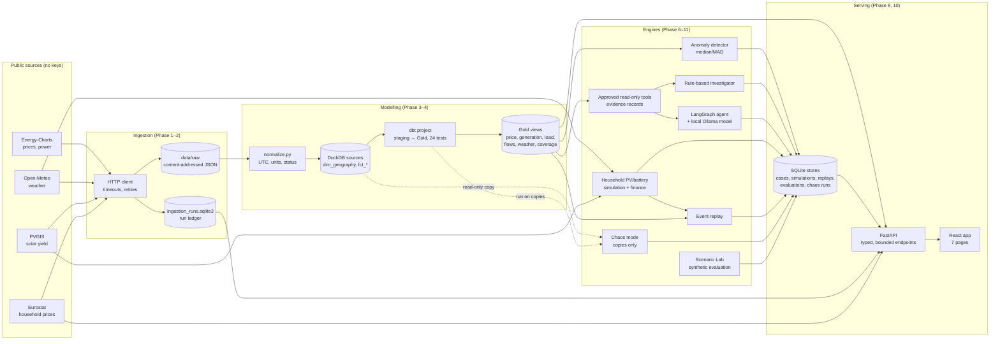

# Architecture

EuroGrid is a local-first application. Public sources are ingested into raw files and a run ledger, normalized into DuckDB, and modelled by dbt into tested Gold views. A FastAPI service reads those views and serves a React app. Deterministic engines (anomaly detection, rule-based investigation, household simulation, replay) run in the API. The only AI component is a local Ollama model, which works inside a LangGraph workflow whose every step is checked by code.



## Boundaries that matter

| Boundary | Rule | Where it is enforced |
|---|---|---|
| Browser ↔ data | The browser never opens DuckDB; every value comes through the API | `frontend/src/lib/api.ts`; the API is the only reader |
| API ↔ database | Read-only connections; parameterised SQL; bounded windows and page sizes | `market_service.py`, `investigation_tools.py`, `api.py` query limits |
| Model ↔ data | The LLM picks a tool *name* from an allowlist; code fills in zone and window; a policy caps calls; there is no SQL input anywhere | `agent_tools.py` (`Literal` tool names, `ToolPolicy`), `api.py` tool allowlist |
| Model ↔ report | Code drops findings without valid evidence, citing unusable evidence, or using causal wording; it re-files "relationships" whose evidence shows no material change; confidence and status are set by rules | `agent.py` `check_report`, `investigation.py` `material_change`, `partial_domain_notes` |
| Production ↔ chaos | Chaos mode attaches production read-only and writes only to `data/chaos/<run>/` | `chaos.py` `build_slice` |
| Real ↔ synthetic | Synthetic rows carry `provider='synthetic'`; the API reports `dataset: synthetic`; the app shows a banner | `synthetic.py`, `/api/health`, `App.tsx` |

## Repository layout

```
eurogrid/                 Python package
  connectors.py http.py   Source connectors and HTTP client (Phase 1)
  ingestion.py cli.py     Raw store, run ledger, backfills (Phase 2)
  normalize.py            DuckDB normalization (Phase 3)
  market_service.py       Market queries and analytics (Phase 5, 10)
  anomaly.py investigation*.py  Detection, tools, rule-based reports (Phase 6)
  simulation*.py pv.py load_profile.py  Household simulation (Phase 7)
  api.py api_models.py *_service.py     API and services (Phase 8, 10, 11)
  agent.py agent_tools.py llm.py        Local LLM agent (Phase 9)
  evaluation.py synthetic.py            Scenario Lab and synthetic data (Phase 10–12)
  replay.py chaos.py demo.py            Event replay, chaos mode, offline demo (Phase 11–12)
eurogrid_analytics/       dbt project (sources, staging, Gold marts, tests)
frontend/                 React + Vite + ECharts app
tests/                    unittest suites (offline; fake LLM and PV providers)
scripts/                  Probes, seeding, Ollama check, dbt check on synthetic data
docs/                     Phase guides, architecture, data dictionary, limitations
```
